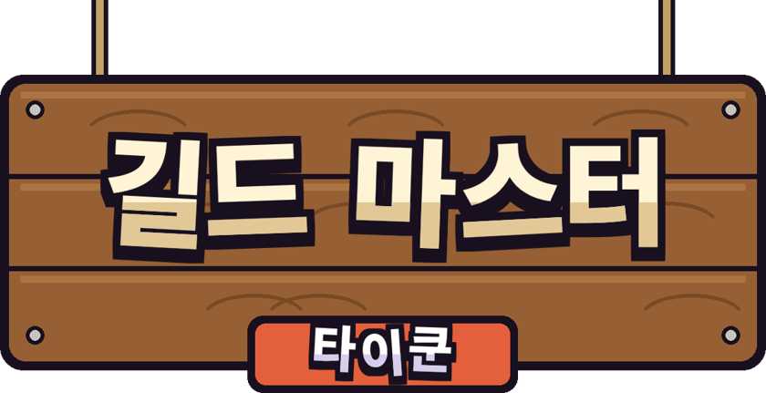
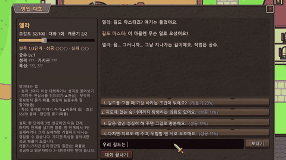
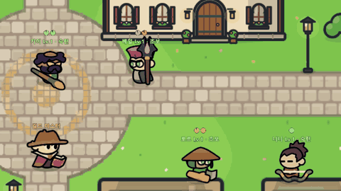
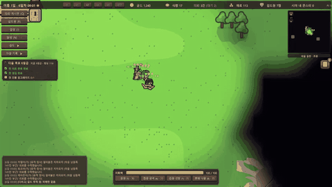
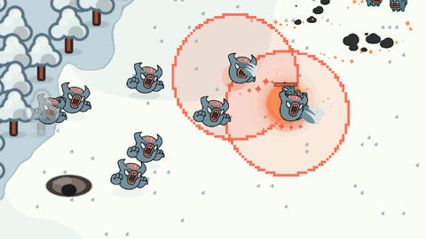
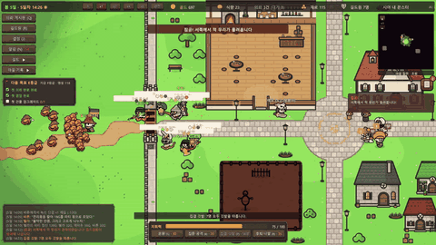
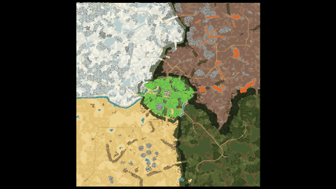
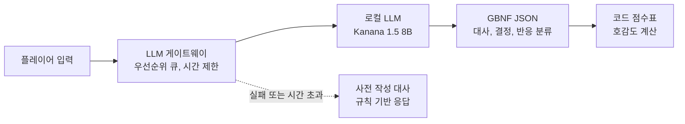

<p align="center">
  
</p>

# 길드 마스터 타이쿤 (Guild Master Tycoon)

> 로컬 LLM 및 자율 AI 에이전트 기반 길드 운영 시뮬레이션

2026-2 아주대학교 SW 미디어 프로젝트 · 팀 **대기고**

| 팀원 | 지도교수 | 멘토 |
| --- | --- | --- |
| 김민석, 이재혁 | 고욱 | 정태홍 |

## 소개

기존 길드 게임은 대부분 플레이어가 캐릭터를 직접 조작해 전투를 진행합니다. 길드 마스터 타이쿤에서 플레이어는 전투원이 아닌 **길드장**이 되어 마을을 운영하고, 스스로 판단하는 모험가들을 **대화로 이끕니다**.

길드원 NPC는 각자의 성격과 가치관, 능력에 따라 의뢰를 고르고 파티를 꾸리며 서로 관계를 맺습니다. 방문자 영입과 면담 같은 대화에는 PC에서 직접 구동되는 **로컬 LLM**을 사용하며, 모델의 응답이 늦거나 실패하더라도 게임 진행에는 영향이 없도록 설계하였습니다.

## 플레이 화면

<table>
  <tr>
    <td width="50%" align="center"><br><b>방문자 영입 대화</b><br>직접 입력한 말에 LLM이 성격에 맞게 대답합니다</td>
    <td width="50%" align="center"><br><b>길드원 간 잡담과 감정 표시</b><br>대화를 나누며 관계가 변합니다</td>
  </tr>
  <tr>
    <td width="50%" align="center"><br><b>안개 속 탐험</b><br>지나간 곳만 지도가 드러납니다</td>
    <td width="50%" align="center"><br><b>몬스터 간 영역 다툼</b><br>몬스터 무리끼리도 영역을 두고 싸웁니다</td>
  </tr>
  <tr>
    <td width="50%" align="center"><br><b>침공 방어전</b><br>마을 안의 길드원 전원이 성문으로 나섭니다</td>
    <td width="50%" align="center"><br><b>지역 군주 보스전</b><br>파티가 함께 지역의 군주에 맞섭니다</td>
  </tr>
</table>

## 주요 기능

- **영입과 면담**: 방문자에게 자유롭게 말을 걸면 LLM이 방문자의 성격과 가치관에 맞는 대답을 생성합니다. 준비된 선택지로도 대화할 수 있어 LLM 없이도 플레이할 수 있습니다.
- **스스로 생각하는 모험가**: 긴급 상황, 정신 상태, 파티 의무, 욕구, 업무, 여가 순의 단계별 판단 구조로 의뢰 수락과 휴식, 사냥을 스스로 결정합니다.
- **관계와 감정**: 잡담과 말다툼으로 관계가 변하고, 뜻이 맞는 길드원끼리 파티를 결성합니다. 스트레스가 쌓이면 태업이나 이탈이 발생하며 면담으로 해소할 수 있습니다.
- **의뢰와 협상**: 마을과 주민, 길드원이 낸 의뢰를 골라 게시하고, 아무도 맡지 않는 의뢰는 보상을 올리거나 설득해서 맡깁니다.
- **살아 있는 생태계**: 시드 기반으로 생성되는 512×512 맵과 전장의 안개, 분위기가 다른 4개 지역이 있습니다. 몬스터도 둥지를 짓고 영역을 다투며, 수가 늘면 이주하거나 마을을 침공합니다. 길드원을 쓰러뜨린 몬스터는 이름이 붙은 숙적이 됩니다.
- **마을 성장과 방어**: 전리품과 골드로 건물을 짓고 성벽을 넓히며, 침공 때는 마을 안의 길드원 전원이 방어에 나섭니다. 길드장은 응원, 집중 공격, 집결 깃발, 후퇴 나팔로 전투를 지휘합니다.
- **보스와 사건**: 지역 군주 4종과 드래곤, 돌발 사건과 재해, 아침 신문과 일일 정산 보고서, 미니게임 3종, 추모의 벽 등이 있습니다. 네 지역의 군주를 모두 쓰러뜨리면 승리합니다.

## LLM 대화 구조

모델은 대사와 반응 유형만 만들고, 점수와 판정은 코드가 맡습니다. 그래서 모델을 바꾸어도 같은 말에는 같은 결과가 나옵니다.



- **온디바이스 실행**: [LLMUnity](https://github.com/undreamai/LLMUnity)(llama.cpp)로 한국어 특화 모델 Kanana 1.5 8B(Q4_K_M)를 PC에서 직접 구동합니다. 별도의 서버나 API 비용이 들지 않습니다.
- **문법 제약 출력**: GBNF 문법으로 모델 출력을 정해진 JSON 형식으로 제한해 항상 해석할 수 있습니다.
- **요청 관리**: 로컬 모델은 한 번에 하나의 요청만 처리하므로 우선순위 큐와 선점, 시간 제한으로 요청을 관리하고, 연속으로 실패하면 모델을 다시 불러옵니다.
- **대체 경로**: 응답이 없거나 LLM을 끈 경우에는 사전 작성 대사(약 6천 문장)와 규칙 기반 응답으로 대신합니다.

## 기술 스택

| 분야 | 사용 기술 |
| --- | --- |
| 엔진 | Unity 6 (6000.3.24f1), URP 2D, Input System |
| 언어 | C# |
| LLM | LLMUnity v3.0.3 (llama.cpp), Kanana 1.5 8B Instruct (GGUF, Q4_K_M) |
| 테스트 | Unity Test Framework (EditMode, PlayMode) |
| 협업 | GitHub, 분업 현황표(`TEAM_TASKS.md`), 기능별 설계 문서 |

## 실행 방법

### 요구 사항

- Unity **6000.3.24f1**
- Windows PC (개발 환경: RTX 5070 Laptop, VRAM 8GB)

### 1. 프로젝트 열기

```bash
git clone https://github.com/Lee37373/mediaproject.git
```

Unity Hub에서 폴더를 열면 `Packages/manifest.json`에 적힌 패키지(LLMUnity 포함)를 자동으로 받습니다.

### 2. 그림 에셋 가져오기

캐릭터, 몬스터, 이펙트, UI 그림은 Unity Asset Store 에셋이며, 라이선스(EULA)상 재배포할 수 없어 저장소에 포함하지 않았습니다. 각자 **Package Manager → My Assets**에서 아래 에셋을 가져와야 합니다.

- LAYERLAB 2D Characters (Cute Adventurers, Casual Monsters, Minimal Characters)
- LAYERLAB 2D Minimal-EnemyMonster
- LAYERLAB Cartoon Casual VFX Pack
- Fantasy Wooden GUI Free

가져온 뒤 폴더 이름을 바꾸지 마세요. 가져오기 설정은 `Scripts/Editor/ArtImportSettings.cs`가 자동으로 적용합니다.

### 3. LLM 모델 준비

`Assets/GuildMaster/Scenes/Main.unity`의 LLM 오브젝트는 `kakaocorp.kanana-1.5-8b-instruct-2505.Q4_K_M.gguf` 파일을 사용합니다. LLMUnity의 모델 관리 화면에서 이 파일을 추가하세요.

모델이 없거나 사양이 부족한 경우에는 게임 안 **설정 → 게임 → AI(LLM)** 를 끄면 사전 작성 대사와 규칙 기반 응답으로 플레이할 수 있습니다.

### 4. 실행

`Assets/GuildMaster/Scenes/Main.unity`를 열고 Play를 누릅니다.

### 5. 빌드

메뉴 **GuildMaster → Windows 빌드**를 실행하면 `Builds/Windows/GuildMasterTycoon.exe`가 만들어집니다. 모델이 함께 포함되어 약 5.3GB입니다. 설치 경로에 한글 등 영문이 아닌 문자가 있으면 모델을 불러오지 못할 수 있으니 영문 경로에 설치하세요.

## 조작법

| 입력 | 동작 |
| --- | --- |
| 마우스 우클릭 | 길드장 이동 |
| WASD, 방향키, 드래그 | 카메라 이동 |
| 마우스 휠 | 확대, 축소 |
| Space | 일시정지, 다시 진행 |
| 5 ~ 8 | 지휘 (응원, 집중 공격, 집결 깃발, 후퇴 나팔) |
| M / C / F5 | 미니맵 / 관전 모드 / 이름표 |
| Q · R · I · U · E · T · B · L | 의뢰 · 길드원 · 창고 · 살림 · 생태계 · 행상인 · 건설 · 정산 |
| O · H · G · K · J · P · V · N · Y | 소식지 · 추모 · 등급 · 도감 · 결정 · 규칙 · 관계도 · 알림 · 할 일 |
| ` | 단축키 도움말 |
| ESC / Shift+ESC | 창 닫기 / 창 모두 닫기 |

## 테스트

Unity 메뉴 **Window → General → Test Runner**에서 실행합니다.

- **EditMode**: 규칙 계산 테스트 (약 5초)
- **PlayMode**: 실제 게임을 띄우는 스모크·회귀 테스트, 고정 시드 사용 (약 1분)

코드를 반영하기 전에 두 테스트를 모두 통과시키는 것을 원칙으로 합니다. 현재 테스트는 860개 이상입니다.

## 프로젝트 구조

```
Assets/GuildMaster/
├── Scenes/Main.unity          # 메인 씬
├── Scripts/
│   ├── Core/                  # 이벤트 버스, 게임 시계, 저장, 오브젝트 풀
│   ├── LLM/                   # LLM 게이트웨이, 백엔드, GBNF 문법
│   ├── Gameplay/              # 게임 시스템 (모험가, 몬스터, 생태계, 의뢰, 마을, 영입 등 42개 모듈)
│   ├── UI/                    # 화면과 창
│   └── Editor/                # 빌드, 모델 교체, 디버그 메뉴
├── Tests/
│   ├── EditMode/              # 규칙 테스트
│   └── PlayMode/              # 스모크·회귀·저장·LLM 장애 테스트
├── Resources/Dialogue/        # 사전 작성 대사 (영입, 면담, 마을 대화)
├── TEAM_TASKS.md              # 분업 현황
├── FEATURE_IDEAS.md           # 기능 기획
├── WORK_SUMMARY.md            # 작업 정리
└── NEGOTIATION.md             # 의뢰 협상 설계
```

## 개발 지표

| 항목 | 값 |
| --- | --- |
| 개발 기간 | 2026.09 ~ 2026.11 |
| 커밋 | 487회 |
| C# 코드 | 약 12만 줄 |
| 자동화 테스트 | 860개 이상 |
| 부하 시 p99 프레임 시간 (유닛 200개, 투사체 100개) | 48.7ms → 13.2ms |
| 프레임당 메모리 할당 | 30KB → 약 5KB |

## 역할 분담

| 이름 | 담당 |
| --- | --- |
| 이재혁 | 맵과 카메라, 전투·자율 AI, 생태계와 몬스터, 파티와 의뢰, LLM 게이트웨이, 마을 건설과 방어, 세이브/로드, 성능 최적화, Windows 빌드 |
| 김민석 | 알림, 스트레스와 면담, 일일 정산 보고서, 죽음과 추모, LLM 의뢰 제안, 의뢰 협상, 대화 DB, 사운드, UI 디자인 |

## 참고

- 그림 에셋은 각 에셋의 라이선스에 따라 저장소에서 제외되어 있습니다.
- LLM 모델은 배포처의 라이선스를 따릅니다.
